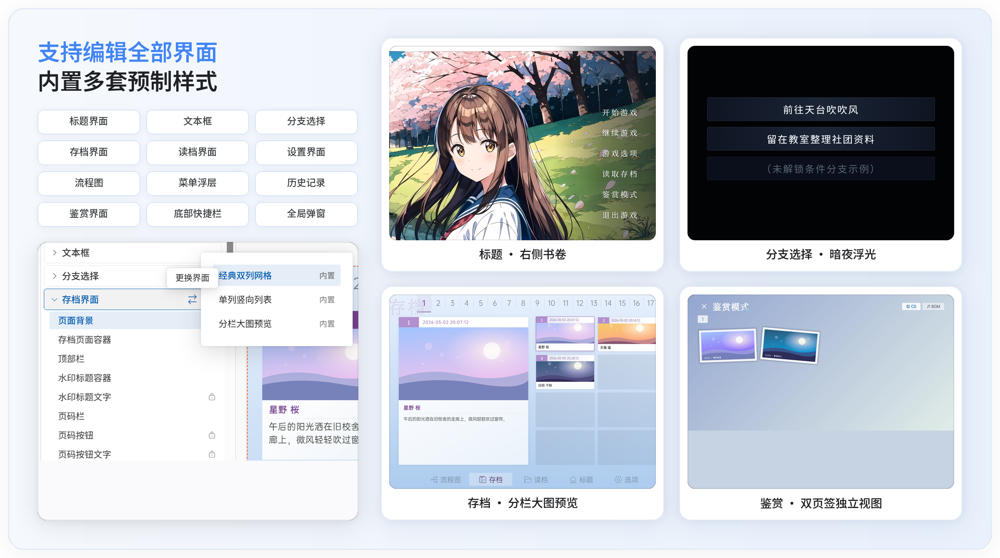
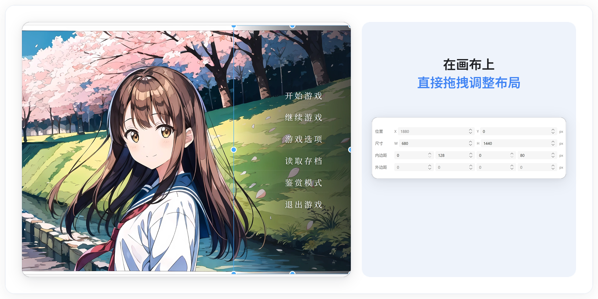
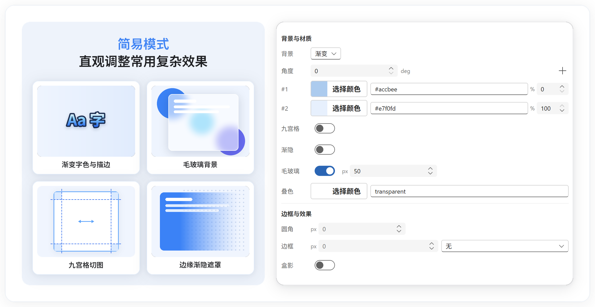
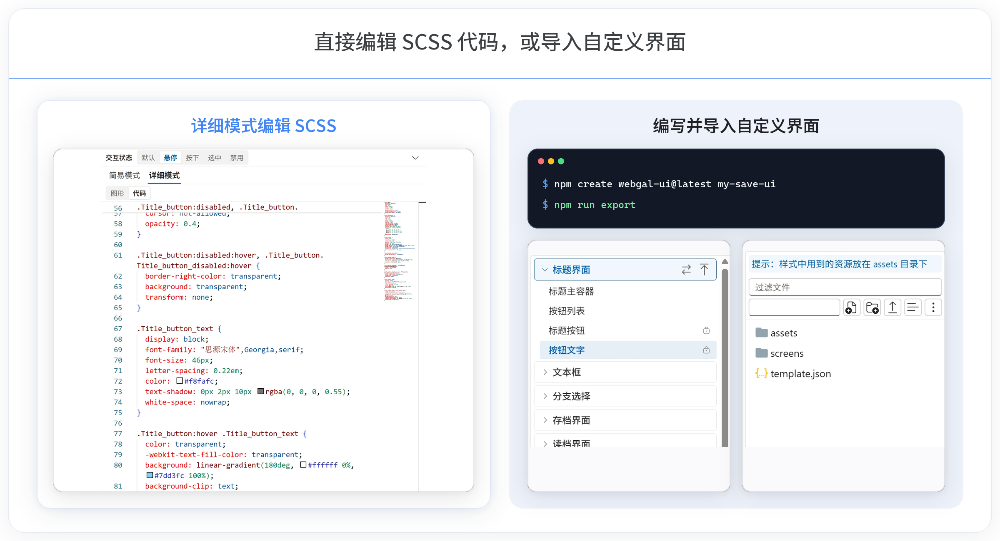

各位关注 WebGAL 的朋友们，久等了。

在 4.5 版本首次加入自定义 UI 时，我们只开放了标题界面和文本框的编辑，调整样式也主要靠逐条修改 CSS 属性。经过重新设计与开发，搭载新版 UI 自定义功能的 **WebGAL 4.7 预览版**现已开放下载。

下面向大家介绍这次更新的主要功能。

## 支持编辑全部界面，并内置多套预制样式

4.7 将标题、文本框、分支选择、存档、读档、设置、流程图、菜单浮层、历史记录、鉴赏、底部快捷栏和全局弹窗全部拆分为独立界面，每一处都可以单独定制；存读档界面也不再写死每页 10 个档位的限制，具体显示多少档位由界面自身决定。

对于存读档、设置、鉴赏这类以列表为主的页面，只改颜色和字号很难改变整体排布。为此我们内置了二十多套预制界面，例如右侧书卷风标题、暗夜浮光分支选项、左侧带大图预览的分栏存读档、单页滚动设置以及双页签鉴赏页，`WebGAL Refine 2026`、`WebGAL Classic` 和 `WebGAL Black` 三套预置模板也已同步按新方案重做。每套界面的样式独立保存，按单个界面来回切换不会覆盖之前修改过的内容。

## 在画布上直接拖拽调整布局

新的模板编辑器采用左、中、右三栏结构，并将舞台与所有界面统一在 `2560 × 1440` 像素画布下。

在「画布编辑」模式下，点击面板或按钮容器即可直接拖动位置、拉拽缩放，也可以在右上角输入精确坐标与边距；由列表自动排列的重复子项会自动锁定定位，只开放外观修改，避免多语言或条目增减时排版错乱。切回「预览交互」模式即可直接测试悬停与点击效果。

预览栏默认开启了「模拟数据」，自动填入对话、选项、存读档记录、历史回看与鉴赏内容，并支持一键将文本框切换为已读状态，无需先去游戏工程里跑剧情造存档就能直接预览效果。

## 简易直观的样式编辑模式

新版将负责背景边框的「容器」与负责排版的「文字」拆分为两个部件，避免按钮背景与内部渐变文字互相冲突。样式面板顶部支持切换「默认、悬停、按下、选中、禁用」五种交互状态——其中新增的「选中」状态专门用于当前页码、当前标签页等常驻高亮项，切换状态时画布也会同步固定展示对应效果。

以前配置渐变字色，需要手动配合透明字色、渐变背景和文字裁剪等多条 CSS 属性，漏掉一项便无法生效。新版「简易模式」将这些需要多属性配合的效果整合为直观的控件，渐变字色、基于 `paint-order` 的文字描边、毛玻璃背景、九宫格切图底框、边缘渐隐遮罩、圆角与阴影均可直接开关和调整。

## 详细编辑模式与自定义界面

需要编写更细节的样式时，可随时切换到「详细模式」使用属性表或内置 SCSS 编辑器。简易模式只更新其对应的属性，不会覆盖你在代码中手写的其他规则。

若内置预制界面的结构仍不满足需求，可以通过脚手架 `npm create webgal-ui@latest` 创建独立的 React 界面工程，编写完成后执行 `npm run export` 打包为 `.zip`，即可在编辑器对应界面旁一键导入；自定义界面运行时若发生报错，引擎会自动回退至默认界面，不会导致游戏卡死。

此外，打开 4.7 之前的旧模板或使用旧模板的游戏时，编辑器会提示一键升级，自动迁移原有的标题、文本框和分支选择样式，并将旧目录备份到 `legacy-backup` 文件夹；旧版遗留的 `applyStyle` 指令在新模板下不再使用，仅在控制台与编辑器内给出提示。

---

目前 WebGAL 4.7 预览版已在下载页开放，欢迎大家试用并在社区反馈问题与建议，我们在正式版更新中再见。

[前往下载 WebGAL 4.7 预览版](/zh-cn/download/prerelease/)
